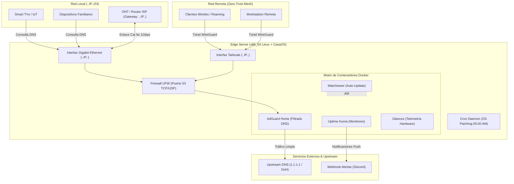

# Edge Homelab & Zero-Trust DNS Appliance


## Descripción Ejecutiva y Propuesta de Valor

Este repositorio documenta el diseño, aprovisionamiento, endurecimiento (*hardening*) y automatización de un servidor de borde (*Edge Appliance*) de bajo consumo energético sobre hardware x86_64 reacondicionado. 

**El Problema:** Las redes domésticas y de pequeñas oficinas dependen de equipos CPE/ONT provistos por operadores de telecomunicaciones (ISP) con firmware bloqueado mediante protocolos de gestión remota (TR-069). Esto impide el control granular del tráfico DNS, expone los dispositivos a telemetría invasiva y carece de visibilidad operativa.

**La Solución:** Despliegue de una arquitectura modular basada en contenedores que centraliza el filtrado DNS a nivel de red local (LAN) y extiende la protección hacia redes externas mediante una malla Zero-Trust (Tailscale). El sistema incorpora gestión térmica física pasiva/activa, respaldo energético integrado (batería nativa como UPS en línea), observabilidad en tiempo real y mantenimiento autónomo desatendido.

---

## Arquitectura del Sistema



---

## Matriz de Componentes y Tecnologías

| Capa | Componente | Tecnología / Herramienta | Rol en la Arquitectura |
| :--- | :--- | :--- | :--- |
| **Hardware & Energía** | Servidor Nodo Base | Chasis Unibody Aluminio (x86_64, SSD SATA III) | Cómputo de bajo consumo (~5.8W en reposo) con batería integrada actuando como UPS en línea. |
| **Conectividad Física** | Enlace de Red LAN | Gigabit Ethernet (1000BASE-T Cat 5e) | Enlace dedicado de baja latencia (< 0.5 ms) con radio Wi-Fi deshabilitada por software. |
| **Sistema Operativo** | Host OS | Linux (Basado en Debian/Ubuntu) | Gestión de recursos, control térmico, firewall (`ufw`) y programación de tareas (`cron`). |
| **Orquestación** | Plano de Control | Docker Engine + CasaOS | Gestión declarativa y visual de microservicios en contenedores. |
| **Seguridad & Red** | Filtrado DNS | AdGuard Home | Sumidero DNS (*DNS Sinkhole*) contra anuncios, rastreadores y telemetría. |
| **Acceso Remoto** | Red Privada Virtual | Tailscale (WireGuard) | Acceso administrativo seguro sin apertura de puertos WAN y DNS cifrado en movilidad. |
| **Observabilidad** | Monitoreo y Métricas | Uptime Kuma + Glances | Seguimiento de disponibilidad con alertas vía Webhook y monitoreo de sensores térmicos/I/O. |
| **Mantenimiento** | CI/CD Operativo | Watchtower + Cron (`apt`) | Parcheo diario desatendido de sistema operativo e imágenes de contenedores a las 05:00 AM. |

---

## Índice de Documentación por Capas

1. [**Capa 01: Infraestructura, Disipación Térmica y Corte de Red (`docs/01-capa-infraestructura-entorno.md`)**](docs/01-capa-infraestructura-entorno.md)
   * Ingeniería térmica en chasis de aluminio, orientación vertical, protección de celdas de litio y migración de Wi-Fi a Gigabit Ethernet.
2. [**Capa 02: Seguridad DNS, Ingeniería de Listas y Red Zero-Trust (`docs/02-capa-seguridad-dns-y-red-mesh.md`)**](docs/02-capa-seguridad-dns-y-red-mesh.md)
   * Optimización de listas de bloqueo (OISD Big + HaGeZi Pro), integración con Tailscale y estrategias de evasión ante bloqueos TR-069 del ISP.
3. [**Capa 03: Observabilidad, Telemetría y Mantenimiento Autónomo (`docs/03-capa-observabilidad-y-automatizacion.md`)**](docs/03-capa-observabilidad-y-automatizacion.md)
   * Auditoría de sensores con Glances, alertas con Uptime Kuma y pipelines de actualización nocturna con Cron y Watchtower.

---

## Guía de Inicio Rápido (Quick Start)

Para replicar la configuración de red y el pipeline de mantenimiento autónomo en un nodo Linux recién instalado con Docker:

```bash
# 1. Clonar el repositorio
git clone [https://github.com/](https://github.com/)<GITHUB_USERNAME>/homelab-edge-appliance.git
cd homelab-edge-appliance

# 2. Otorgar permisos de ejecución a los scripts de automatización
chmod +x scripts/*.sh

# 3. Ejecutar el corte de red hacia Ethernet, apagar Wi-Fi y abrir el puerto DNS (53)
sudo ./scripts/network_cutover.sh --interface <ETH_INTERFACE> --disable-wifi

# 4. Configurar actualizaciones desatendidas del SO y desplegar Watchtower (05:00 AM)
sudo ./scripts/setup_maintenance.sh --hour 5
```
